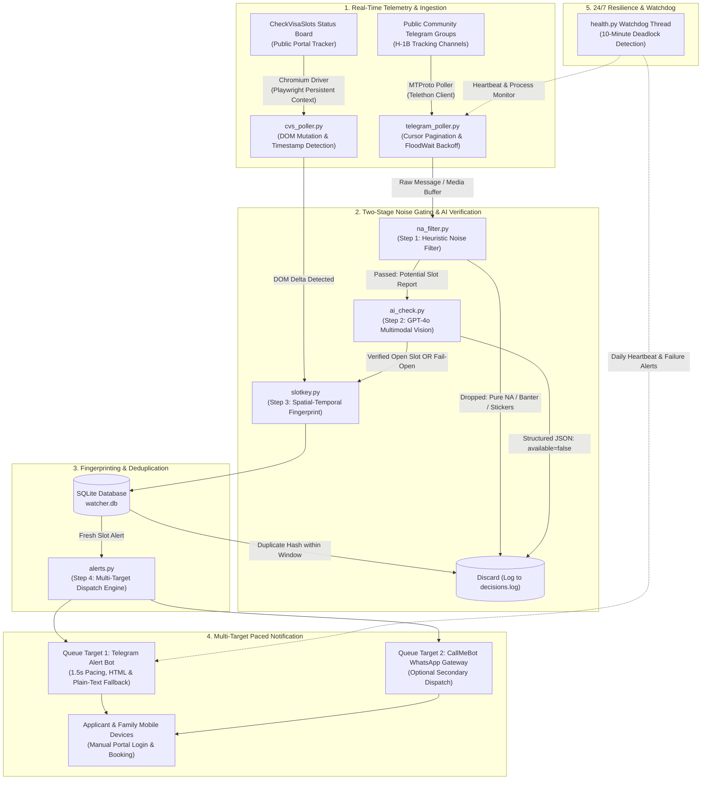

# Visa Appointment Monitoring & Real-Time Alert Engine

[](https://github.com/SambhavJain26/visa-appointment-alerts/actions)
[](https://www.python.org/)
[](https://github.com/LonamiWebs/Telethon)
[](https://playwright.dev/)
[](https://openai.com/)
[](https://www.docker.com/)
[](LICENSE)

An autonomous 24/7 appointment slot monitoring and real-time alert engine that ingests community Telegram feeds and portal availability, filters noise via multi-modal AI verification, and dispatches zero-latency push alerts through an isolated Telegram bot.

---

## The Problem Solved

Booking an H-1B visa stamping appointment (OFC biometrics and consular interview) in India presents severe operational challenges for working professionals:

* **Unpredictable Release Windows**: Embassy slots open erratically without advance notice, often in small batches at odd hours (2:00 AM to 5:00 AM IST), and disappear within 60 to 120 seconds.
* **The "Portal Lockout Trap"**: Directly scraping the official portal (usvisascheduling.com) triggers Cloudflare bot challenges, IP blocks, and 72-hour account lockouts. Booking accounts are easily suspended if automated tools hit the portal directly.
* **Extreme Chatter Noise**: Public community groups receive 5,000+ messages per day, but over 98% of traffic consists of questions, stickers, chat banter, and negative reports ("NA 1 H1B All").
* **Human Monitoring Fatigue**: No individual can monitor Telegram channels and community trackers 24 hours a day without missing critical drop windows.

This engine replaces manual channel stalking with a **passive, read-only telemetry architecture**. It continuously listens to community crowdsourced signals, validates screenshots and message text using multi-modal AI, merges duplicate slot reports across channels, and pushes instant notifications to family members so they can log in and book safely by hand.

---

## Architectural Guarantee: Strictly Read-Only

The engine enforces strict architectural safety boundaries verified by automated regression tests (`tests/test_safety.py`):
* **Zero Portal Interaction**: It never sends HTTP requests, authenticates, or touches usvisascheduling.com, ustraveldocs, or any official consular portal. **It never books.**
* **Passive Telegram Listener**: The Telethon MTProto client acts strictly as an in-memory listener. It never posts messages, reacts, forwards, joins channels, or sends direct messages from the user account.
* **Isolated Alert Surface**: The outbound alert bot operates exclusively via the official Telegram Bot API (`sendMessage`, `sendPhoto`) and ignores all incoming user messages.
* **Ephemeral In-Memory Media**: Verification screenshots are streamed directly into memory buffers for OpenAI Vision API evaluation and never persisted to the disk.

---

## System Architecture



---

## Core Mechanics & Resilience Engineering

### 1. Two-Stage Noise Reduction Pipeline
* **Stage 1 (Deterministic Heuristic Gating)**: `na_filter.py` applies high-speed regex filters to drop pure "NA" messages, service messages, empty payloads, and media stickers without consuming LLM API tokens (filtering out ~85% of raw messages).
* **Stage 2 (Multimodal AI Verification)**: `ai_check.py` invokes OpenAI GPT-4o with structured JSON schema outputs. It analyzes OCR text and attached screenshots simultaneously to confirm actual booking availability versus speculative inquiries ("Is Hyderabad open?").
* **Fail-Open Safety Boundary**: If the OpenAI API encounters a network timeout, rate limit, or invalid response, the system automatically **fails open**, generating an urgent alert flagged as `(AI check failed - please look)`. A critical slot opening is never lost due to upstream API downtime.

### 2. Spatial-Temporal Fingerprinting (`slotkey.py`)
When slots drop, dozens of users broadcast the same discovery across multiple groups within seconds. `slotkey.py` computes an immutable fingerprint combining:
$$\text{fingerprint} = \text{hash}(\text{appointment\_type}, \text{consulate\_city}, \text{earliest\_date}, \text{time\_bucket})$$
Incoming alerts matching an existing fingerprint within a 15-minute sliding window are deduplicated, protecting applicants from notification floods.

### 3. Distributed Queue Pacing & Error Fallback
* **Per-Recipient Queues**: Alerts are dispatched through independent, thread-safe asynchronous queues so a delay or block on one recipient does not stall delivery to others.
* **Automatic Protocol Degradation**: Messages are formatted with HTML tags highlighting the city, date range, and slot count. If the Telegram Bot API rejects the payload due to unescaped entities, the dispatcher catches the exception and immediately resends the alert in raw plain text.
* **Rate-Limit Compliance**: Outbound sends are spaced 1.5 seconds apart per chat to respect Telegram Bot API limits, dynamically adjusting to any `retry_after` headers returned by the server.

### 4. 24/7 Supervisor & Deadlock Watchdog (`health.py`)
* **Process Watchdog**: A background daemon thread tracks timestamps of event loop iterations. If the Telegram poller or asyncio loop hangs for more than 10 minutes without yield, the watchdog forces a process exit, allowing Docker (`restart: unless-stopped`) to perform a clean container reboot.
* **FloodWait Handling**: The Telethon MTProto client intercepts Telegram `FloodWaitError` responses, pauses polling for the exact duration requested by Telegram, and resumes without losing cursor positions.
* **Daily Heartbeat Telemetry**: Sends an automated 24-hour health report displaying uptime, total messages ingested, noise filtration ratios, and current cursor offsets.

---

## Repository Structure

```
visa-appointment-alerts/
├── .github/
│   └── workflows/
│       └── ci.yml               # GitHub Actions CI running 160+ unit & safety tests
├── docs/
│   ├── cvs-access-checks.md     # CheckVisaSlots access audit notes
│   ├── cvs-rate-limit-investigation.md # Anti-blocking & rate-limit investigation
│   └── operations-notes.md      # Production runbook & server telemetry notes
├── tests/
│   ├── test_alert_targets.py    # Multi-recipient queue routing & pacing tests
│   ├── test_cvs_poller.py       # CheckVisaSlots DOM extraction & delta checks
│   ├── test_na_filter.py        # 50+ heuristic noise classification test cases
│   ├── test_pipeline.py         # End-to-end filter, AI check, and dispatch flow
│   ├── test_safety.py           # Static safety verification (zero portal writes)
│   └── test_slotkey.py          # Spatial-temporal deduplication hashing tests
├── watcher/
│   ├── __init__.py              # Package root
│   ├── __main__.py              # CLI entry point (run, login, replay, test-filter)
│   ├── ai_check.py              # Multimodal GPT-4o vision verification & fail-open logic
│   ├── alerts.py                # Multi-target alert dispatcher with queue pacing
│   ├── app.py                   # Main orchestration supervisor & loop management
│   ├── config.py                # Type-safe environment configuration loader
│   ├── cvs_poller.py            # Playwright Chromium reader for portal tracker
│   ├── db.py                    # SQLite state engine for message offsets & dedup
│   ├── health.py                # Thread-safe watchdog & daily heartbeat emitter
│   ├── na_filter.py             # Deterministic regex noise & NA classifier
│   ├── slotkey.py               # Slot fingerprinting & grouping algorithm
│   ├── telegram_poller.py       # Telethon MTProto cursor-based group listener
│   └── timeutil.py              # Timezone normalization (UTC, IST, EST)
├── Dockerfile                   # Multi-stage production container definition
├── docker-compose.yml           # Production Docker Compose orchestration
├── docker-entrypoint.sh         # Container initialization script
├── requirements.txt             # Locked Python runtime dependencies
├── .env.example                 # Sanitized configuration template
└── README.md                    # System architecture & developer documentation
```

---

## Technical Decisions & Trade-offs

| Engineering Choice | Selected Approach | Alternative Rejected | Why This Approach Won |
| :--- | :--- | :--- | :--- |
| **Operational Scope** | **Read-Only Telemetry Engine** | Automated Booking Bot | Booking bots violate embassy terms of service, trigger Captcha gates, and lead to 72-hour account bans. Instant alerts allow humans to book legitimately with zero ban risk. |
| **Ingestion Protocol** | **MTProto Client (Telethon)** | Telegram Bot API | Standard Telegram bots cannot read messages in public community channels without being added as channel administrators. MTProto user sessions enable passive listening across public community channels. |
| **Classification Architecture** | **Two-Stage (Heuristic + Multimodal LLM)** | End-to-End LLM Prompting | Pumping 5,000+ messages daily through GPT-4o would cost $15-$30/day with 1.5s latency per message. The regex heuristic drops 85%+ of noise in sub-millisecond time, cutting API costs to cents. |
| **Safety Handling** | **Fail-Open on Model Errors** | Fail-Closed (Suppress Alert) | In appointment monitoring, a false positive is easily ignored by an applicant, but a false negative causes a missed embassy opening. Failing open ensures zero lost opportunities. |
| **State Persistence** | **SQLite with WAL Mode** | In-Memory Set / Redis | SQLite provides zero-dependency, crash-resilient persistence for message cursor positions and deduplication hashes without needing an external database daemon. |

---

## Quickstart & Local Setup

### 1. Clone Repository & Setup Environment
```bash
git clone https://github.com/SambhavJain26/visa-appointment-alerts.git
cd visa-appointment-alerts

# Create and activate Python virtual environment
python -m venv .venv

# Windows PowerShell
.\.venv\Scripts\Activate.ps1

# Linux / macOS
source .venv/bin/activate

# Install dependencies
pip install -r requirements.txt pytest
```

### 2. Configure Environment Variables
```bash
cp .env.example .env
```
Edit `.env` and provide your API credentials:
```ini
# Telegram User Session (for MTProto group reading)
TELEGRAM_API_ID=12345678
TELEGRAM_API_HASH=abcdef0123456789abcdef0123456789
TELEGRAM_GROUPS=h1b_visa_slots_india,us_visa_chennai

# Outbound Notification Bot
TELEGRAM_BOT_TOKEN=123456789:ABCdefGhIJKlmNoPQRstuVWXyz
TELEGRAM_ALERT_CHATS=applicant|123456789,spouse|987654321

# Multimodal Verification
OPENAI_API_KEY=sk-proj-...
```

### 3. Verification CLI Commands
Test individual pipeline components without triggering live alerts:
```bash
# Test heuristic noise filter
python -m watcher test-filter "NA 1 H1b All Chennai"

# Test multimodal vision and text verification
python -m watcher test-ai "Chennai OFC open for Nov 24" --image samples/test_slot.png

# Test outbound bot delivery
python -m watcher test-alert "System verification ping"

# Replay last 30 messages across community groups in dry-run mode
python -m watcher replay --limit 30
```

### 4. Run Test Suite
```bash
python -m pytest tests/ -v
```

---

## Production Deployment (Docker)

To run the monitoring engine continuously on a Linux VPS:

```bash
# 1. Build container image
docker compose build

# 2. Interactive one-time Telegram MTProto login
docker compose run --rm -it watcher python -m watcher login

# 3. Dry-run replay verification
docker compose run --rm watcher python -m watcher replay --limit 30

# 4. Start 24/7 background service
docker compose up -d

# 5. Inspect live decision audit log
docker compose exec watcher tail -f data/logs/decisions.log
```

---

## Project Metadata & Authorship

* **System Architect & Author**: Sambhav Jain
* **Project Type**: Production Automation & Event-Driven Notification Engine
* **License**: MIT
