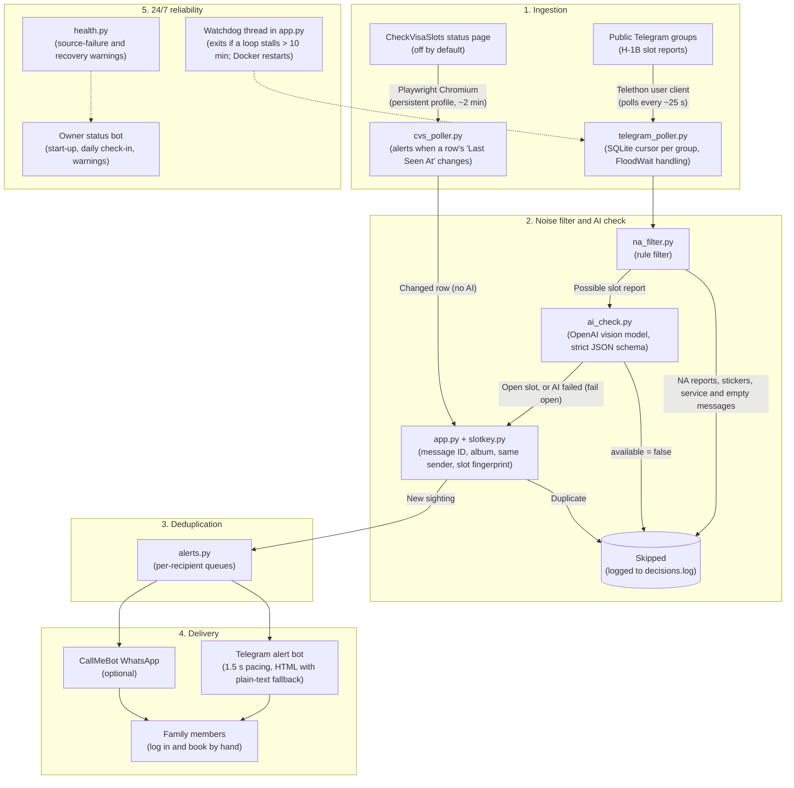

# Visa Appointment Monitoring & Real-Time Alert Engine

[](https://github.com/SambhavJain26/visa-appointment-alerts/actions)
[](https://www.python.org/)
[](https://github.com/LonamiWebs/Telethon)
[](https://playwright.dev/)
[](https://openai.com/)
[](https://www.docker.com/)

A 24/7 read-only watcher that reads public Telegram groups and the CheckVisaSlots status page, filters out noise
with rules and an OpenAI vision check, merges duplicate reports, and sends alerts through a Telegram bot when someone
reports open H-1B OFC or interview slots in India. A person still books by hand on the official portal.

Built for a family member who needed an H-1B visa stamp. **Its alerts led to a booked appointment.**

> **Before you run it:** the CheckVisaSlots reader is **off by default** (`CVS_ENABLED=false`). The Telegram reader only reads public groups and never posts.

---

## The Problem Solved

* **Unpredictable release windows:** slots open rarely, at no fixed time, and are taken quickly.
* **Booking bots put accounts at risk:** automating the official portal can get an applicant's account suspended,
  so this project never touches it.
* **Noisy community groups:** most messages in the public slot groups are questions, stickers, chat and "NA"
  (not available) reports. Many real sightings are screenshots with no text.
* **Nobody can watch 24/7:** checking several groups and a website around the clock isn't realistic for a person.

The watcher does the watching. It reads the groups and the status page, keeps only posts that report open slots,
merges repeats of the same sighting, and alerts family members so they can log in and book by hand.

---

## Architectural Guarantee: Strictly Read-Only

These boundaries are checked by automated tests (`tests/test_safety.py`):
* **No portal interaction:** it never sends requests to, authenticates with, or touches usvisascheduling.com,
  ustraveldocs, or any consular portal. **It never books.**
* **Read-only Telegram account:** the Telethon client only resolves group usernames, reads message history and
  downloads images. It never posts, reacts, forwards, joins groups or sends direct messages.
* **Send-only alert bot:** the alert bot uses the official Telegram Bot API to send messages and photos. The service
  never reads bot updates and has no webhook, so nothing anyone types to the bot can affect it.
* **Screenshots stay in memory:** images are downloaded into memory for the vision check and not written to disk.

---

## System Architecture



---

## Core Mechanics & Resilience Engineering

### 1. Two-Stage Noise Filter
* **Stage 1 (rules):** `na_filter.py` drops pure "NA" reports, stickers, service messages and empty messages
  before any model call, so most chatter never costs an API request.
* **Stage 2 (vision model):** `ai_check.py` sends the text and any screenshot to a small OpenAI vision model
  (configurable; default `gpt-6-luna`, with an automatic fallback model) using a **strict JSON schema** response.
  It returns whether slots are available, the appointment type, the city and any dates.
* **Fails open:** if the model times out, errors or returns bad JSON, a post that still looks like a sighting
  (a screenshot, availability words or dates, or a city with an appointment word) is alerted anyway, marked
  `(AI check failed - please look)`. A model outage never silently hides a real opening.

### 2. Deduplication
The same opening is often posted several times across groups. Before an alert is queued, `app.py` skips:
* a message that was already alerted (keys stored in SQLite),
* other images from the same album,
* the same person posting the same text or screenshot in several groups within **5 minutes**,
* the same slot reported again within **2 minutes**, using a fingerprint from `slotkey.py`:
```python
slot_key = f"{appointment_type}|{city}|{first_date}"   # e.g. "biometrics|chennai|2026-11-24"
```
If the city or the date can't be pinned down, there is no fingerprint and the alert is always sent.

### 3. Alert Delivery
* **Per-recipient queues:** a failing chat never delays the others.
* **Retries:** transient errors are retried with backoff (5 s to 10 min); permanent errors (bot blocked, bad token)
  are not.
* **HTML with plain-text fallback:** if Telegram rejects the HTML, the alert is resent as plain text.
* **Rate limits:** sends are spaced 1.5 seconds apart per chat, and Telegram's `retry_after` is respected.

### 4. 24/7 Supervisor & Watchdog
* **Supervised loops:** the Telegram, alert and housekeeping loops restart with backoff after a crash. If the process
  dies, Docker restarts it (`restart: unless-stopped`) and it resumes from the saved message IDs.
* **Watchdog:** a separate thread in `app.py` exits the process if the Telegram loop or the event loop stops for more
  than 10 minutes, and Docker restarts it. Telegram flood-waits are honoured and don't count as freezes.
* **Health warnings:** `health.py` sends one warning when a source has been failing (for example Telegram, the AI
  check or CheckVisaSlots) and one when it recovers. A daily check-in confirms the watcher is alive.
* **No stale alerts:** posts older than 30 minutes, such as a backlog after downtime, are never alerted.

---

## Repository Structure

```
visa-appointment-alerts/
├── .github/workflows/ci.yml     # GitHub Actions: compile check + full pytest suite
├── docs/
│   ├── cvs-access-checks.md     # CheckVisaSlots access checks (403 diagnosis)
│   ├── cvs-rate-limit-investigation.md # Rate-limit page investigation
│   └── operations-notes.md      # Dated operations notes
├── tests/                       # 160 tests, including read-only safety checks (test_safety.py)
├── watcher/
│   ├── __main__.py              # CLI: run, login, replay, test-filter, test-ai, test-alert, bot-chats
│   ├── ai_check.py              # OpenAI vision check, strict JSON schema, fails open
│   ├── alerts.py                # Per-recipient alert queues, pacing, retries, plain-text fallback
│   ├── app.py                   # Wiring, deduplication, supervised loops, watchdog, daily check-in
│   ├── browser_network.py       # Optional request counting for the CheckVisaSlots browser
│   ├── config.py                # Settings from environment variables
│   ├── cvs_poller.py            # Playwright Chromium reader for the CheckVisaSlots table
│   ├── db.py                    # SQLite (WAL): group cursors, page snapshot, alerted keys, stats
│   ├── health.py                # Source-failure and recovery warnings
│   ├── na_filter.py             # Rule-based noise filter
│   ├── slotkey.py               # Slot fingerprint (type, city, first date)
│   ├── telegram_poller.py       # Read-only Telethon poller
│   └── timeutil.py              # IST and display time zones
├── Dockerfile                   # Python 3.12 slim + Chromium + Xvfb, non-root user
├── docker-compose.yml           # 24/7 service with restart policy and memory limits
├── docker-entrypoint.sh         # Starts the virtual display, then the watcher
├── requirements.txt             # Pinned dependencies
└── .env.example                 # Configuration template
```

---

## Technical Decisions & Trade-offs

| Engineering Choice | Selected Approach | Alternative Rejected | Why |
| :--- | :--- | :--- | :--- |
| **Scope** | **Read-only alerts** | Automated booking bot | Automating the portal can get the applicant's account suspended. An alert lets a person book by hand. |
| **Reading Telegram** | **Telethon user client (MTProto)** | Telegram Bot API | A bot can only read groups it has been added to. A user client can read public groups by username. |
| **Classification** | **Rules first, then a vision model** | Sending every message to the model | Most messages are obvious noise; the rule filter drops them for free and only possible sightings reach the model. |
| **Model failures** | **Fail open** | Fail closed (suppress the alert) | A false alarm costs a glance; a missed opening costs the appointment. |
| **State** | **SQLite (WAL mode)** | In-memory only / Redis | Crash-safe cursors and alert history with no extra database server. |

---

## Quickstart & Local Setup

### 1. Clone and install
```bash
git clone https://github.com/SambhavJain26/visa-appointment-alerts.git
cd visa-appointment-alerts

python -m venv .venv
# Windows PowerShell
.\.venv\Scripts\Activate.ps1
# Linux / macOS
source .venv/bin/activate

pip install -r requirements.txt pytest
```

### 2. Configure
```bash
cp .env.example .env
```
Fill in `.env` (see `.env.example` for every option):
```ini
# Telegram user account, used only to read public groups (my.telegram.org -> API development tools)
TELEGRAM_API_ID=
TELEGRAM_API_HASH=
TELEGRAM_GROUPS=group_username_1,group_username_2

# Your alert bot (from @BotFather) and who receives alerts (get chat IDs with: python -m watcher bot-chats)
TELEGRAM_BOT_TOKEN=
TELEGRAM_ALERT_CHATS=me|<chat_id>,family|<chat_id>

# Vision check
OPENAI_API_KEY=
```

### 3. Try the pieces without sending alerts
```bash
python -m watcher test-filter "NA 1 H1b All Chennai"                         # rule filter decision
python -m watcher test-ai "Chennai OFC open for Nov 24" --image shot.png    # filter + AI check
python -m watcher replay --limit 30      # what would have been forwarded (no alerts, no state change)
python -m watcher test-alert "hello"     # one message to each alert target
```

### 4. Run the tests
```bash
python -m pytest tests/ -v
```

---

## Production Deployment (Docker)

```bash
cp .env.example .env && chmod 600 .env          # fill it in; keep DRY_RUN=true at first
mkdir -p data && chown 10001:10001 data && chmod 700 data
docker compose build
docker compose run --rm -it watcher python -m watcher login          # one-time Telegram login
docker compose run --rm watcher python -m watcher replay --limit 30  # dry-run check
docker compose up -d                                                 # start the 24/7 service
tail -f data/logs/decisions.log                                      # every SKIP / FORWARD decision
```

To go live, set `DRY_RUN=false` in `.env` and run `docker compose up -d` again.

**The Telegram session file gives full access to the account.** It stays under `data/` (chmod 600) and is excluded
by `.gitignore` and `.dockerignore`.

---

## Project Metadata & Authorship

* **Author**: Sambhav Jain
* **Project Type**: Personal project, running 24/7 for a family member
